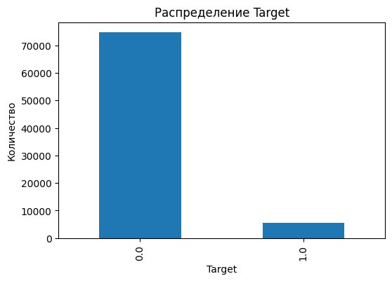
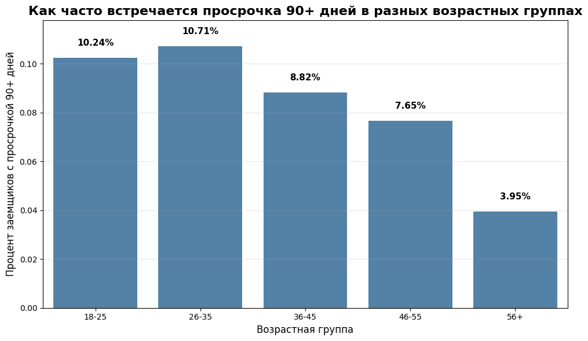
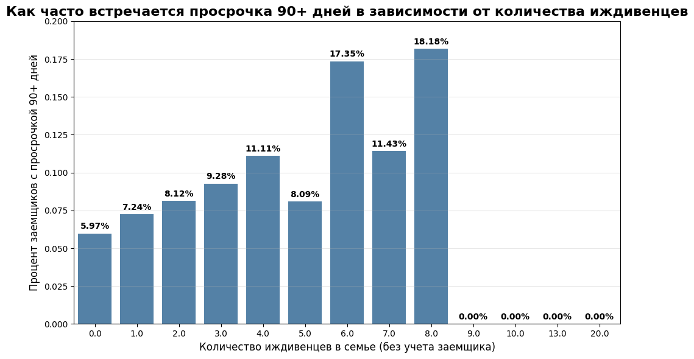
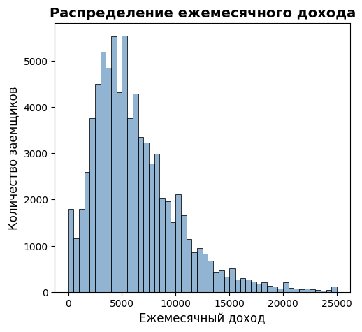
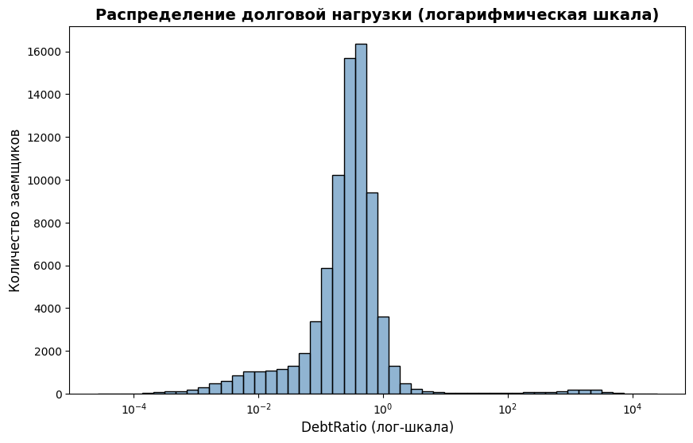
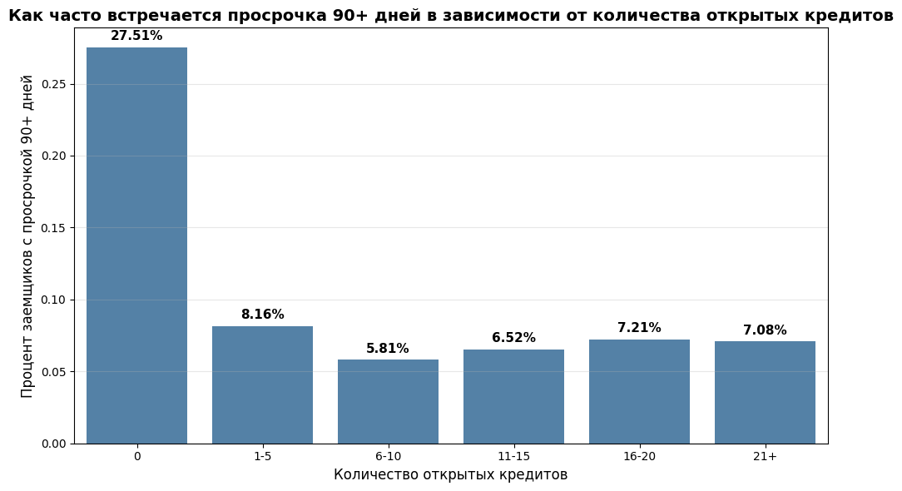

# Прогнозирование кредитного дефолта (Кредитный скоринг)

## 1. Постановка задачи
**Цель:** Разработать модель машинного обучения для предсказания вероятности того, что заемщик будет испытывать финансовые трудности (просрочка 90+ дней) в ближайшие 2 года.
**Тип задачи:** Бинарная классификация.
**Целевая переменная:** Target (0 — надежный клиент, 1 — дефолт).
**Метрика качества:** ROC-AUC (выбрана из-за сильного дисбаланса классов).

## 2. Разведочный анализ данных (EDA)
В ходе анализа датасета было выявлено несколько важных особенностей:
*   **Дисбаланс классов:** 93% клиентов не имеют просрочек, и только 7% являются дефолтными. Обычная точность (Accuracy) здесь не подходит, поэтому упор сделан на ROC-AUC.
*   

*   **Анализ возраста:** Молодые заемщики (18-35 лет) показывают наибольшую долю просрочек (около 10.5%), тогда как среди заемщиков старше 55 лет этот показатель снижается до 3.95%. Возраст — значимый фактор.
*   

*   **Анализ дохода:** Распределение дохода имеет длинный правый хвост (выбросы до 3 млн). Медиана составляет около 5 000, поэтому признаки с такими распределениями требуют масштабирования или логарифмирования.

*   **Долговая нагрузка (DebtRatio):** Обнаружено много аномалий (значения более 100% от дохода). Для обучения модели признак был ограничен разумным порогом.

## 3. Предобработка данных
*   Обработаны пропуски (заполнены медианными значениями).
*   Удалены или ограничены экстремальные выбросы (DebtRatio, MonthlyIncome).
*   Создан новый признак **TotalPastDue** (сумма всех просрочек).
*   Категориальные признаки (AgeGroup) переведены в дамми-переменные (One-Hot Encoding).

## 4. Моделирование и подбор гиперпараметров
Было обучено и протестировано 10 различных алгоритмов классификации, включая:
*   K-Nearest Neighbors (KNN)
*   Логистическая регрессия (LogReg)
*   Дерево решений (Decision Tree)
*   Random Forest
*   Gradient Boosting
*   XGBoost

Для каждого алгоритма был проведен подбор гиперпараметров с помощью `GridSearchCV` и кросс-валидации. 

## 5. Результаты и выбор лучшей модели
Лучший результат на валидационной выборке показал **ансамбль (ensemble)** из двух моделей: **Random Forest** (с глубиной 10) и **Gradient Boosting**.

*   **ROC-AUC ансамбля: 0.937** (отличный показатель для задачи кредитного скоринга).
*   Ансамбль усредняет предсказания двух алгоритмов, что снижает дисперсию и делает прогноз более надежным.

## 6. Интерпретация модели (Feature Importance)
С помощью логистической регрессии и встроенной важности признаков в деревьях было выявлено, какие факторы сильнее всего влияют на риск дефолта:
1.  **MonthlyIncome (Доход):** Самый важный фактор. Чем выше доход, тем ниже риск.
2.  **Age (Возраст):** Второй по важности. Чем старше заемщик, тем он надежнее.
3.  **PastDueLess_60 (Мелкие просрочки):** Если человек часто опаздывал на 30-59 дней, велика вероятность, что дойдет и до 90+.

## 7. Выводы
1.  Для банка критически важно учитывать не только доход, но и возраст, а также историю мелких просрочек.
2.  Гибридные модели и ансамбли (Random Forest + Boosting) показывают наилучшее качество на несбалансированных данных.
3.  Модель готова к внедрению в скоринговую систему для предварительной оценки риска.

## Файлы
*   `source/project.ipynb` — Jupyter Notebook с полным кодом EDA, очистки и обучения моделей.
*   `source/Презентация ТОНСиМО.pptx` — презентация с визуализацией результатов.
